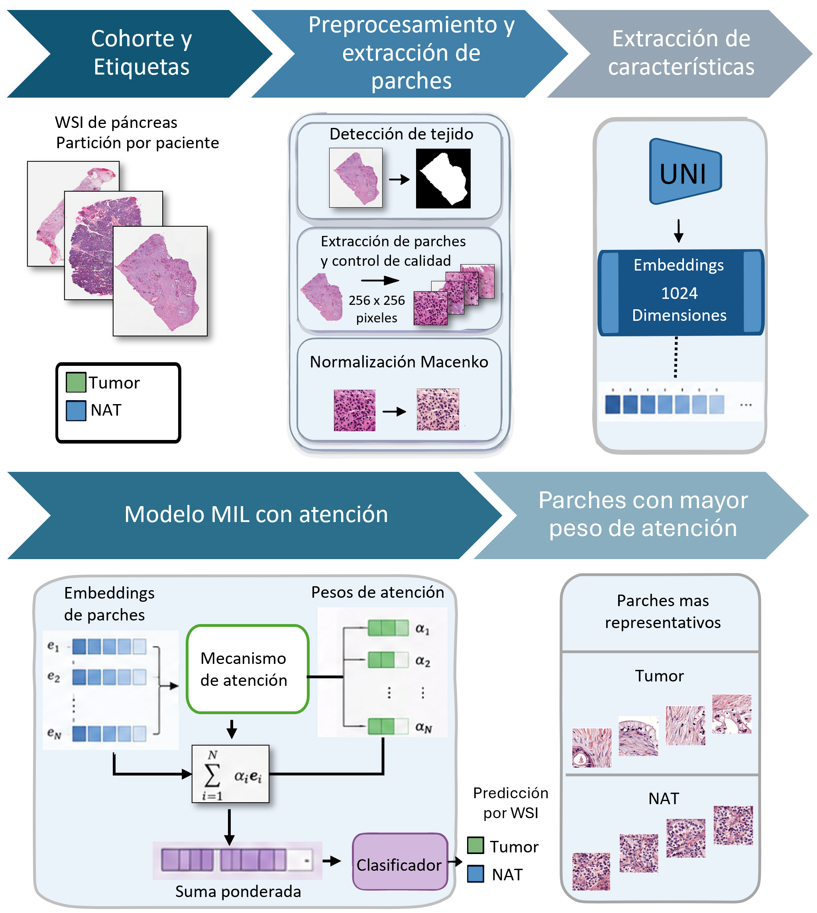
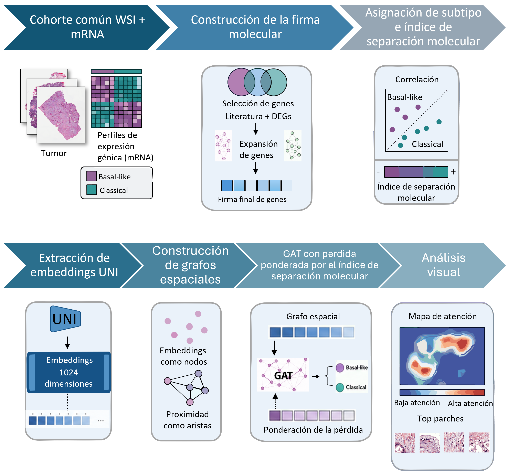

# Detección de tejido pancreático neoplásico con aprendizaje profundo integrando imágenes histológicas y perfiles moleculares

Trabajo de titulación de la Maestría en Ingeniería Biomédica con mención en Informática Médica.

**Autor:** Eugenio Sebastián Andrade Roldán  
**Tutor:** Pablo Andrés Salamea Cordero

Este repositorio contiene el código desarrollado para clasificar tejido tumoral frente a tejido normal adyacente (NAT) y predecir etiquetas de subtipo molecular del adenocarcinoma ductal pancreático (PDAC) a partir de imágenes histopatológicas.

El trabajo comprende dos etapas. La primera utiliza embeddings histológicos y Attention Multiple Instance Learning (Attention MIL). La segunda utiliza UNI y una Graph Attention Network (GAT), con etiquetas y pesos de entrenamiento derivados de perfiles transcriptómicos. En esta segunda etapa, la transcriptómica proporciona supervisión molecular; las predicciones se obtienen a partir de información histológica y relaciones espaciales entre parches.

## Primera etapa: clasificación de tejido tumoral frente a NAT

  

El procedimiento incluye:

- Detección de tejido y extracción de parches de 256 × 256 píxeles.
- Control de calidad y normalización de color mediante Macenko.
- Extracción de embeddings mediante UNI o ResNet50.
- Clasificación de cada WSI mediante Attention MIL.
- Visualización de los parches con mayor peso de atención.

NAT corresponde a tejido normal adyacente de pacientes con PDAC; no representa muestras de controles sanos.

La cohorte comprende 556 WSI de 168 pacientes. La partición se realizó por paciente, manteniendo todas sus WSI en un único subconjunto:

| Subconjunto | Pacientes | WSI |
|---|---:|---:|
| Entrenamiento | 117 | 392 |
| Validación | 25 | 87 |
| Prueba | 26 | 77 |

Cada WSI constituye una bolsa independiente de embeddings. Las predicciones y las métricas se calculan por WSI, sin agregación por paciente.

UNI genera embeddings de 1024 elementos y ResNet50 de 2048. La comparación utiliza un protocolo común de Attention MIL y entrenamiento, adaptando la dimensión de entrada a cada extractor. Los checkpoints se seleccionan mediante el mayor AUC de validación y se evalúan posteriormente en prueba, con un umbral de clasificación de 0.5.

### Resultados en prueba

El conjunto de prueba incluye 27 WSI NAT y 50 tumorales.

| Modelo | Accuracy (IC 95 %) | F1 tumoral (IC 95 %) | AUC (IC 95 %) |
|---|---|---|---|
| UNI + Attention MIL | 0.909 (0.837–0.974) | 0.928 (0.862–0.980) | 0.976 (0.954–0.997) |
| ResNet50 + Attention MIL | 0.805 (0.697–0.908) | 0.842 (0.747–0.927) | 0.890 (0.803–0.960) |

Los intervalos de confianza se estimaron mediante 10 000 remuestreos bootstrap por paciente, conservando juntas sus WSI, con semilla 42 y manteniendo fijos los modelos y el umbral.

La comparación corresponde a una única partición y semilla de entrenamiento. No establece por sí sola una superioridad generalizable ni la significancia estadística de las diferencias.

## Segunda etapa: clasificación molecular Classical y Basal-like

  

El procedimiento incluye:

- Vinculación de imágenes tumorales y perfiles transcriptómicos por paciente.
- Preprocesamiento transcriptómico y construcción de la firma molecular utilizando exclusivamente entrenamiento.
- Asignación de etiquetas Classical y Basal-like.
- Cálculo del índice de separación molecular.
- Extracción de embeddings histológicos mediante UNI.
- Construcción de grafos espaciales entre parches.
- Entrenamiento de la GAT con pérdida ponderada por clase y por paciente.
- Visualización de mapas de atención y parches con mayor peso de atención.

Se incluyeron 140 pacientes, con una WSI tumoral seleccionada por paciente: 98 para entrenamiento, 21 para validación y 21 para prueba.

El índice de separación molecular es la diferencia absoluta entre los puntajes de las firmas Basal-like y Classical. No representa una probabilidad ni la proporción de células tumorales.

El peso de cada paciente se calcula a partir del índice normalizado utilizando exclusivamente los parámetros de entrenamiento:

`sample_weight = 0.5 + 0.5 × indice_normalizado`

El modelo final conserva los 98 pacientes de entrenamiento. En validación y prueba, el peso de muestra se fija en 1. La sección 3.1 conserva marcas de un filtrado exploratorio que no se utiliza para excluir pacientes en el entrenamiento final.

La GAT recibe embeddings histológicos y conexiones espaciales. Los perfiles transcriptómicos proporcionan las etiquetas y los pesos de entrenamiento, sin incorporarse como vectores de entrada.

En los 21 pacientes de prueba, UNI + GAT alcanzó una exactitud de 0.857, un F1-score de 0.800 para Basal-like y un AUC de 0.843. No se realizó una comparación con ResNet50 en esta etapa.

## Organización del repositorio

- `UNI_Attencion_MIL_Tumor_NAT/`: notebooks de clasificación tumor/NAT, comparación con ResNet50, imagen de referencia para Macenko y notas de reproducibilidad.
- `UNI_GAT_Basal_Classical/`: notebook de subtipificación molecular y notas de reproducibilidad.
- `images/`: esquemas metodológicos de ambas etapas.

### Notas de reproducibilidad

- [UNI, Macenko y compatibilidad de software](UNI_Attencion_MIL_Tumor_NAT/REPRODUCIBILIDAD.md)
- [UNI + GAT y ponderación de la pérdida](UNI_GAT_Basal_Classical/REPRODUCIBILIDAD.md)

## Fuentes de datos públicas

- **Imágenes histopatológicas:** [TCIA CPTAC-PDA](https://www.cancerimagingarchive.net/collection/cptac-pda/).
- **Datos transcriptómicos:** [GDC CPTAC-3](https://portal.gdc.cancer.gov/projects/CPTAC-3).

## Entorno y dependencias

El procesamiento y entrenamiento se realizaron en un equipo con 16 GB de RAM y una GPU NVIDIA GeForce RTX 3050 de 8 GB, utilizando Python y Jupyter Notebook.

Las principales bibliotecas utilizadas incluyen:

- PyTorch y torchvision.
- PyTorch Geometric.
- timm y huggingface_hub.
- OpenSlide y openslide-python.
- NumPy y pandas.
- SciPy y scikit-learn.
- scikit-image y OpenCV.
- Pillow, Matplotlib, seaborn y tqdm.

La disponibilidad de CUDA permite ejecutar la extracción y el entrenamiento en una GPU compatible. Las WSI, los parches, los embeddings y los archivos intermedios requieren una capacidad considerable de almacenamiento.

El acceso a los pesos de UNI está sujeto a las condiciones de su repositorio oficial. Los pesos de UNI no se distribuyen aquí.

## Ejecución

1. Obtener los datos originales desde los repositorios oficiales.
2. Instalar las dependencias y configurar el acceso a UNI.
3. Adaptar las rutas locales de entrada y salida de los notebooks.
4. Consultar las notas de reproducibilidad de cada etapa.
5. Ejecutar las celdas en orden, comprobando los archivos y subconjuntos utilizados.
6. Mantener separados los archivos de cada extractor y etapa.

Las rutas de Windows incluidas en los notebooks corresponden al equipo original y deben ajustarse antes de ejecutar el código.

## Alcance y limitaciones

El estudio utiliza una única cohorte y no cuenta con validación externa. La comparación entre extractores se restringe a tumor frente a NAT y se realizó con una única partición y semilla de entrenamiento.

Las etiquetas moleculares se derivaron de una firma transcriptómica y no constituyen una clasificación clínica independiente. Los pesos de atención permiten explorar el comportamiento de los modelos, pero no equivalen a una validación histopatológica de regiones individuales.

## Uso académico

Este repositorio tiene fines académicos y de investigación. Los resultados no constituyen una herramienta clínica validada.

Los conjuntos de datos originales, los parches y los embeddings no se distribuyen en este repositorio. Deben obtenerse o generarse siguiendo las condiciones de las fuentes correspondientes.
